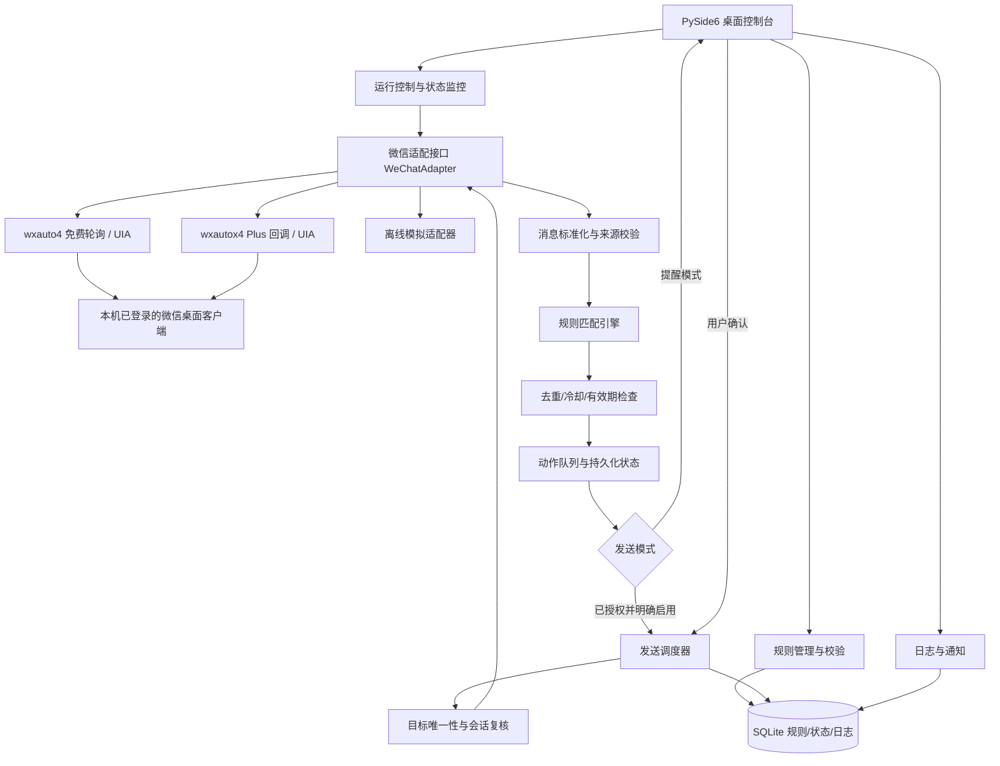
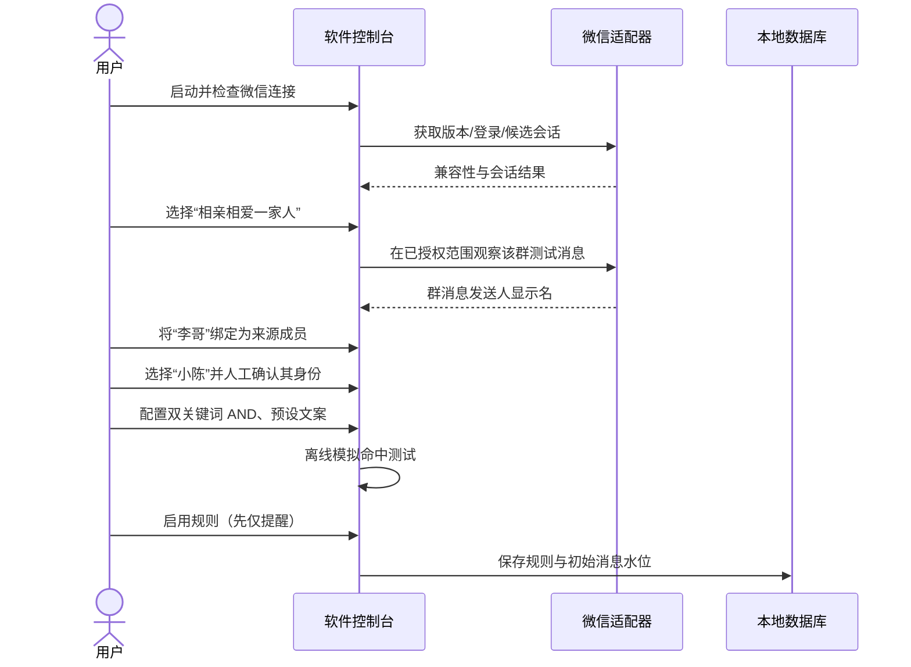
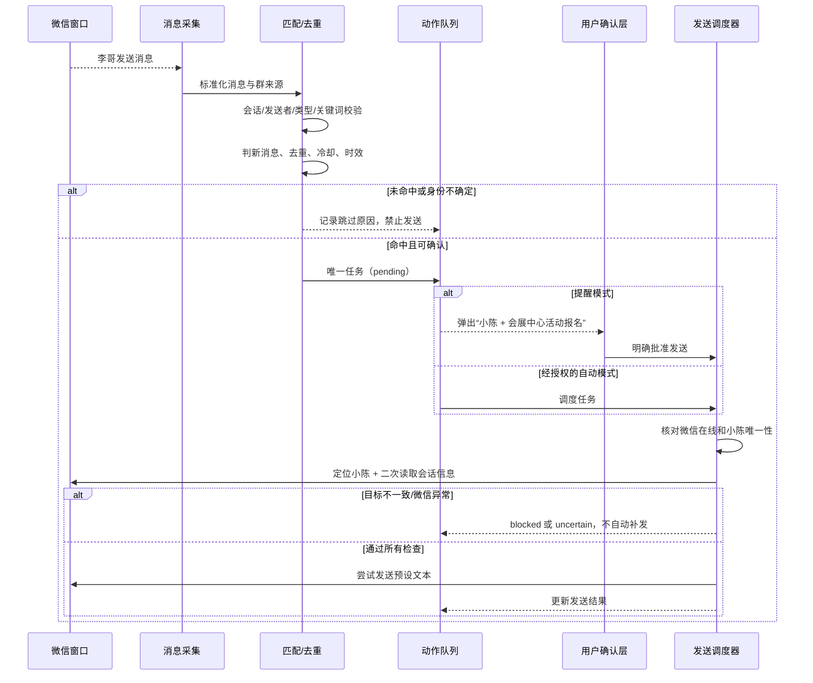
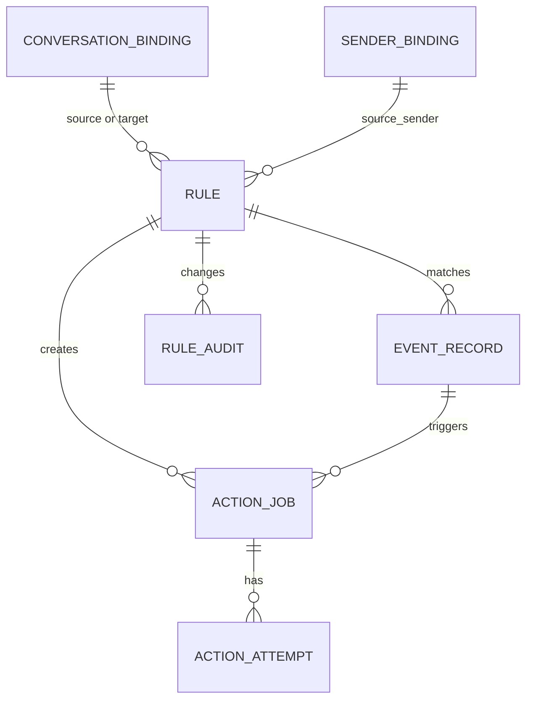

# 微信电脑版定向消息监听与自动回复软件：技术调研与详细设计方案

> **文档类型**：产品需求文档（PRD）＋技术选型报告＋系统概要/详细设计（HLD/LLD）＋实施与测试方案  
> **版本**：v1.0｜**调研日期**：2026-11-05  
> **目标平台**：Windows 10/11、已由用户自行登录的微信 PC 客户端  
> **预期技术栈**：Python 3.11/3.12、PySide6、SQLite、Windows UI Automation（UIA）  
> **调研边界**：基于公开项目仓库、产品文档、平台协议及 Windows 官方开发文档的*资料核查*；**未在用户本机安装微信进行端到端实测**。凡涉及实时性能、版本兼容及具体控件行为，均作为**待现场验证**的工程假设，而非已证实结论。

---

## 0. 先读结论：可实现什么，必须警惕什么

### 0.1 核心结论

拟开发的软件可以被设计为：**从用户已登录的微信桌面会话中读取可见消息 → 精确过滤“群聊 + 群成员 + 关键词” → 对命中事件去重、限频和核验 → 在另一指定微信联系人会话中创建一条预设消息**。

但需要严格区分三层含义：

1. **技术可设计**：Windows UIA、第三方封装库、消息匹配和桌面输入控制均存在技术基础。[R01–R05]
2. **工程能否可靠运行**：取决于当前微信客户端版本、UIA 控件可访问性、群成员名称能否唯一识别、窗口状态及第三方库适配情况，须在目标电脑上完成 PoC（概念验证）。
3. **平台是否允许**：**不能将“技术能做到”等同于“微信官方许可”**。腾讯现行公开《微信软件许可及服务协议》第 8.2.1.6 条，明确限制未经许可利用非腾讯授权第三方软件等进行自动化操作、访问或控制微信界面/数据的行为，第 8.5 节列有账号处置措施。[R09] **即使使用 UIA 而不是 Hook，也不意味着自动得到腾讯授权。**

据此，本报告将功能设计成可切换的两种模式：

- **建议默认：提醒＋人工确认发送模式**。完成精准监测、命中弹窗、目标会话与文案预填；只有用户确认后才尝试发送。它降低误发和无意消息的风险，但不能保证整套第三方读取/操作行为符合微信协议，仍应取得必要授权。
- **技术研究模式：命中后自动发送**。作为可行性与架构分析对象保留；是否投入真实个人账号使用，应先核对最新微信协议和授权情况，不能承诺不会被限制或封号。

### 0.2 推荐的工程路线

**优先级 A：** 用 `wxauto4` 免费能力＋显式轮询建立本地原型，验证识别群/消息、群发言者区分、跨会话定位；文档明确免费版不含 Plus 的直接监听 API。[R01][R06]  
**优先级 B：** 对真实稳定监听有要求、且确认授权/许可条件后，再评估 `wxautox4` Plus 的 `AddListenChat` 回调模式；其官方文档提供 `Message.sender`、`Message.content`、`ChatInfo`、`SendMsg` 等需要的接口。[R01–R03]  
**不建议默认使用：** DLL 注入、Hook、协议模拟、破解/解密微信数据库等方式。它们存在更高的维护、安全、账号及合规风险；WeChatFerry 主要面向 3.9 系客户端，其原仓库已于 2026-07-10 归档。[R07]

### 0.3 核心验证闸门（Go / No-Go）

在写完整业务 UI 前，依次确认：

| 编号 | 现场试验 | 通过标准 | 未通过时的策略 |
|---|---|---|---|
| G1 | 连接当前登录微信 | 能识别登录状态/主窗口/当前客户端版本 | 停止接入，报告不兼容 |
| G2 | 查看目标群最近消息 | 能区分新旧消息，读取至少一条实际测试文本 | 改为仅提示用户手动打开会话，或暂停开发 |
| G3 | 区分群内李哥与其他人 | 能获取发言者显示名，并经过用户手动绑定校验 | 禁止自动发送，退化为“群级提醒” |
| G4 | 定位小陈私聊 | 搜索结果能够被确认为唯一目标，发送前二次比对 | 标为目标不明确，不允许发送 |
| G5 | 相同消息重复读取 | 只生成一条待发送任务 | 改进去重/水位逻辑，不上线 |
| G6 | 微信更新、窗口最小化、重启 | 检测失联/兼容变化后安全停止，不误发 | 进入暂停状态并通知用户 |
| G7 | 账号与聊天授权范围 | 使用方式获得必要授权并符合适用平台规则 | 只保留离线模拟器和不调用微信的规则测试 |

---

## 1. 产品背景、目标与范围

### 1.1 典型业务场景

用户是微信群“**相亲相爱一家人**”的成员。群主“**李哥**”发布活动通知，助手“**小陈**”负责登记。用户希望群内出现李哥发送且同时包含“**活动报名**”和“**会展中心**”的文字消息时，软件及时准备发给小陈：

> 会展中心活动报名

**这不是普通的“群内自动回复”**：触发事件发生在群 A，而目标消息发送到**联系人 B 的私聊会话**。系统必须在“监听源”和“执行目的地”之间建立清晰、独立、经用户确认的绑定。

### 1.2 需求规格化

| 字段 | 场景样例 | 业务含义 |
|---|---|---|
| 来源类型 | `group` | 仅来源于微信群 |
| 来源会话 | `相亲相爱一家人` | 必须精确匹配目标群 |
| 来源发言者 | `李哥` | 只处理指定群成员发言 |
| 消息类型 | `text` | V1 仅处理纯文本，不对图片 OCR、语音转文字自动触发 |
| 关键词 | `活动报名`、`会展中心` | 默认同一条消息内**全部包含**（AND） |
| 匹配方式 | 子串包含 | 不区分全角/半角空格的可选归一化；不进行语义猜测 |
| 执行会话类型 | `friend` | 给另一个已确认联系人发私聊 |
| 执行会话 | `小陈` | 需要唯一目标绑定和发送前复核 |
| 执行文案 | `会展中心活动报名` | 原样发送，不自动改写 |
| 重复触发 | 同一来源消息只处理一次 | 持久化去重；可另加规则冷却时间 |
| 初始模式 | 提醒＋用户确认 | 防止误发及非预期自动操作 |

### 1.3 V1 必须具备（MVP）

- 识别本机已登录的微信主窗口并显示连接、登录、兼容性状态。
- **仅按用户点选的范围**加载最近会话与必要联系人信息；无“全量导出所有聊天”默认动作。
- 新建、编辑、禁用、启用、删除规则；支持多个规则。
- 规则可限定群聊、发言人、关键词、目标联系人、消息文本。
- 关键词 `AND / OR`、可选大小写/空白归一化、匹配预览。
- 消息监听、排除自己发送、排除历史消息、识别系统消息。
- 去重、冷却、每日发送上限、触发消息有效期、运行暂停。
- “仅提醒 / 人工确认发送”模式和完整的模拟发送（dry-run）。
- 发送前目标二次校验、发送结果状态、失败保守处理。
- 本地日志、规则备份导入导出、开机后手动启动/停止。

### 1.4 V1 不做

- 不登录用户微信账号、不读取密码、二维码登录凭证或设备密钥。
- 不批量添加陌生人、不多账号群控、不营销群发、不抢红包/自动支付。
- 不通过破解、Hook、DLL 注入、修改内存或规避风控来获取数据。
- 不从所有聊天中搜刮和上传联系人、照片、语音、附件或历史记录。
- 不默认调用云端 AI；确定性字符串匹配已足够解决此场景。
- 不支持 Windows 锁屏、注销、远程桌面断开等情况下的“保证实时监听”。
- 不承诺无人值守、毫秒级响应、消息绝不漏读、网络端到端送达保证。

### 1.5 建议补充的 V1.1 / V2 能力

V1.1：多关键词组合分组、排除词、时间段、只触发一次/每活动一次、多规则优先级、编辑与撤销窗口、不同消息模板。  
V2：可信消息来源校验、可配置延迟合并多条发言、通知渠道、插件化适配其他**具有官方 API 或明确授权**的聊天平台。  
不建议将“AI 理解活动报名”设为第一版的基础依赖，避免误判和隐私外发。

---

## 2. 公开项目调研：别人如何实现

### 2.1 检索与评估口径

核查对象覆盖**桌面 UI 自动化库、微信自动回复样例、微信 4.x 适配、Hook 框架、Windows 官方 UIA 资料与平台条款**。项目页面展示的功能属于作者声明；本报告没有复现其全部功能，因此不将 README 中的“无风险”“不会漏消息”等表述直接视为实际保证。

项目筛选优先度：① 是否适配微信 4.x；② 能否获取群消息发送者；③ 是否支持发给不同聊天对象；④ 是否能分辨消息新旧；⑤ 是否需要非官方注入/解密；⑥ 是否有维护/授权成本；⑦ 是否具备失败保护机制。

### 2.2 项目对比总表

| 项目 | 公开实现路径 | 可借鉴之处 | 关键限制 / 结论 | 引用 |
|---|---|---|---|---|
| **wxauto / wxauto4 / wxautox4** | Windows UI Automation；4.1 客户端适配 | 会话定位、发送消息、UI 消息对象；Plus 回调、群发言者字段 | 免费/Plus API 不同；免费版文档目前最高支持微信 4.1.8.107；Plus 需激活；第三方非官方 | [R01–R03] |
| **pgszz/wechat-auto-reply-ai** | Python + Tkinter + wxauto | 好友/群聊监听、指定群发送者、关键词配置、冷却、异步发送和日志 | README 针对微信 3.9.12.57；其“快发/预填”有误发风险，不宜原样照搬 | [R04] |
| **cocobond/wxauto_reply** | Python + wxauto + AI 接口 | 私聊与群聊规则、排除自己消息、上下文组织 | 更偏“原会话 AI 回复”，与跨会话指定发给小陈不同；版本/运行限制需验证 | [R05] |
| **br1nosense/dsh-wxauto-plugin** | wxauto4 免费版＋`GetSession` 轮询 | 明确展示“免费版没有 Plus 监听接口”时的回退策略、`isnew` 检测与去重 | 轮询可能造成已读、漏读和 UI 冲突；适合作为原型参考，不代表稳定可靠 | [R06] |
| **FreeWisdom/wxauto-4.0** | 基于 UIA 的 4.x 社区适配 | 微信 4.x UI 结构、问题回归、消息 ID 与窗口状态检查思路 | 社区仓库已知窗口最小化会影响监听、最后消息偶尔定位失败；应核对真实许可证和版本 | [R08] |
| **WeChatFerry** | 对微信客户端进行 Hook | 结构化消息事件、联系人/群消息模型、语言 SDK 设计思路 | 主要适配历史 3.9 分支；2026-07-10 原仓库归档；注入与平台风险高，不选 | [R07] |
| **wx4auto（第三方）** | UIA + 产品自述的本地数据库增量方案 | “水位线持久化”“消息去重”“发送前目标核验”工程理念 | 其数据库路径涉及数据访问授权/安全边界；不引入为默认实现，文档宣传需独立验证 | [R10] |
| **pywinauto + 原生 UIA** | Windows Win32 / UIA 控件树 | 不依赖某一个微信封装库，可自建适配层与健康检查 | 需自己维护每个微信版本的控件定位，开发成本较高 | [R11][R12] |

### 2.3 逐项分析与可以移植的设计思想

#### A. wxauto4 / wxautox4：最贴近目标功能

其 4.x 文档区分免费版 `wxauto4` 和 Plus 版 `wxautox4`：

- 免费版安装示例：`pip install wxauto4`（文档列出的 Python 支持范围为 3.9–3.12）。
- Plus 版安装示例：`pip install wxautox4`（文档列出的 Python 支持范围为 3.9–3.13），须按其许可规则激活。
- 文档中标注 `✨` 的接口为 **Plus 专用**：`AddListenChat`、`RemoveListenChat`、`StartListening`、`GetNextNewMessage`、`GetFriendDetails` 等；因此不能为免费版直接编写这些调用并声称可运行。
- 通用基础方法包括 `GetSession`、`ChatWith`、`ChatInfo`、`SendMsg`、`GetAllMessage`。
- 消息对象文档提供 `type`、`attr`、`sender`、`content`、`id`；特别提醒 **UI ID 切换界面后会变化**，`hash` 也可能重复，不宜单独作为持久化幂等键。
- 群成员 `sender` 是**群消息显示名称**，不天然等于唯一且不可变的微信身份 ID。这里是本产品最重要的风险点。

**结论**：对“指定群 + 指定发言人 + 指定目标私聊”的语义支持最直接，但需评估收费、版本兼容以及发送时窗口/线程竞争。[R01–R03]

#### B. 现成自动回复项目：业务逻辑比底层框架更有参考价值

`pgszz/wechat-auto-reply-ai` 已有图形界面、关键词规则、群发言者限制、回复冷却和日志，证明“用可视化配置代替硬编码”是成熟的设计方向。但其 README 指明微信 3.9.12.57 且窗口保持可见，不能直接推断适配 4.1；“把消息提前放进输入框”的模式可能误发给错人。本项目应优先采用**发送时定位＋目标核验**，而不是抢速度式预填。[R04]

`cocobond/wxauto_reply` 展示了只响应特定私聊或群消息的处理链路与排除自己消息思路；AI 模型能力与本项目无关，可以先去掉，降低延迟、成本和数据出站风险。[R05]

#### C. 免费轮询方案：可证明原型，但不是可靠订阅 API

`dsh-wxauto-plugin` README 说明：使用免费 `wxauto4` 时，利用 `GetSession()` 的新消息标记识别候选会话，再打开窗口读取消息，辅以去重。优点是无需付费监听回调；缺点是操作会话可能把消息标记已读、影响用户操作，读取的 UI 只包含已加载/可见内容，不能推断能捕获所有群消息。[R06]

适合初期回答三件事：当前微信能否连接？能否识别李哥？能否安全定位小陈？**通过后再讨论真实发送**。

#### D. Hook / 内存 / 协议路线：仅作风险对照

WeChatFerry 使用 Hook 架构获取较结构化的消息和联系人信息，跨会话能力强，但与微信小版本紧耦合，且其原仓库已归档。其他注入项目的适配声明不能代替安全审计。考虑平台协议、账户风险和维护成本，**本项目不提供注入操作步骤，也不依赖此路线**。[R07][R09]

#### E. 合规接口路线：适合重构场景，不等价于个人微信群

企业微信自建应用/微信客服有面向特定业务的官方消息接口，但并不开放用户普通个人微信账号中任意现有微信群的全量消息流。只有**业务发起人愿意改变通知渠道/接入方式**，例如活动信息通过一个授权的应用或服务发布时，这些 API 才可替代第三方桌面监听。不要误认为“部署企业微信”就可以合法监听原有“相亲相爱一家人”群。[R13]

---

## 3. 技术路线比较与最终选型

### 3.1 多方案评价（工程判断，不是实测排名）

| 维度 | 原生 UIA 自研 | wxauto4 免费版轮询 | wxautox4 Plus 回调 | Hook/协议模拟 | 官方业务 API（重构场景） |
|---|---|---|---|---|---|
| 读取自己电脑可见微信消息 | 条件可行 | 条件可行 | 文档支持 | 技术可能 | 不覆盖原个人群 |
| 精确发言人筛选 | 自研解析 | **待验证** | 有 `sender`，仍须校验 | 通常更结构化 | 取决于服务场景 |
| 跨会话发消息 | 自研 | `SendMsg` | `SendMsg` | 可能 | 限授权业务会话 |
| 是否依赖特定微信版本 | 高 | 高 | 高 | 极高 | 与桌面版本解耦 |
| 接入成本 | 开发量高 | 低 | 有授权费用/条款 | 维护与风险高 | 需要业务改造 |
| 监听可靠性 | 需自测 | UI 轮询限制明显 | 回调模型较易组织；仍受 UI 状态影响 | 版本与安全问题 | 接口范围内较适合生产 |
| 平台许可 | 非官方自动化有风险 | 同左 | 同左 | 侵入性更高 | 受接口授权范围约束 |
| 本项目定位 | 备用适配层 | **原型首选** | **有条件的候选增强** | 不采用 | 可选长期替代 |

> **重点**：上述评价是依据公开接口与架构做的技术判断，未对任何方案进行账号安全性实测，也没有“降低封号概率”的量化依据。UIA 不是“官方批准”的同义词。

### 3.2 推荐栈

| 层级 | 组件 | 选型理由 |
|---|---|---|
| 语言 | Python 3.11 / 3.12 | 兼顾 `wxauto4` 文档免费版兼容范围、Qt、SQLite、测试生态 |
| 桌面 GUI | PySide6 | Windows 体验、表格、树形联系人选择、系统托盘、信号槽与线程管理 |
| 微信适配 | `WeChatAdapter` 抽象接口 | 支持免费轮询适配器、Plus 回调适配器、全离线模拟适配器替换 |
| UIA 底座 | wxauto4 或 pywinauto / uiautomation | 根据客户端适配结果选择；不使用注入 |
| 规则引擎 | Python 标准库 `re`、`unicodedata` | 确定性、可单元测试、避免外部 AI 依赖 |
| 任务队列 | 进程内有界队列 + SQLite 状态 | 单机低频场景，无需 Redis、RabbitMQ |
| 本地持久化 | SQLite（WAL，单写入者） | 规则配置、消息指纹、发送任务状态、事件日志 |
| 日志 | Python `logging` + 结构化 JSON | 便于调试和回归；缺省脱敏 |
| 测试 | pytest + pytest-qt（可选） | 匹配、去重、状态机、GUI 自动测试 |
| 打包 | PyInstaller / Nuitka（择一实测） | 输出 Windows 可执行文件；注意打包授权和病毒软件误报 |

### 3.3 环境与版本准入

1. 优先以本机正在使用的 **官方微信客户端版本** 为准，不为兼容第三方库要求用户安装不安全、不明来源的旧客户端。
2. `wxauto4` 文档查询时明确写有“免费版最新支持到微信 4.1.8.107”；若本机高于该版本，**不可假定兼容**。[R01]
3. `wxautox4` 的微信 4.1 文档和特定接口能否在当前小版本运行，也要通过 G1–G6 验证；付费不等于稳定保证。
4. 屏幕分辨率、缩放比例、Windows 登录会话、微信窗口是否最小化、微信语言（简体/英文）均需写入兼容测试表。
5. 不要求/不应尝试在锁屏、验证码、安全验证提示时绕过官方控制。

---

## 4. 系统总架构

### 4.1 模块结构图



### 4.2 核心设计准则

- **源会话与目标会话完全分离**：不把“回复对象”默认理解成当前会话，也不把群主名字当成好友对象。
- **身份优先于速度**：如果群成员、群聊或目标联系人有歧义，则拒绝执行，不进行模糊猜测。
- **默认不跨重启补发**：重连时不把旧活动通知当作新消息群发；如确有补发需求，必须单独审批且设置期限。
- **同一条消息的处理链仅创建一次动作**；重复消息读取不能再进入发送队列。
- **所有对微信 UI 的写操作串行化**；不允许监听线程、配置界面和发送线程同时争抢微信输入焦点。
- **最小权限/最小采集**：只索引明确选择的群与发言者，对大部分无关聊天不读取正文，不保留完整聊天备份。
- **可观察、可暂停、可恢复**：不明状态时“停发优先”，不盲目自动重试。

### 4.3 组件职责与接口边界

| 模块 | 输入 | 输出 | 边界条件 |
|---|---|---|---|
| `ClientDetector` | 系统窗口、微信版本 | 连接状态 / 版本信息 | 多进程、多窗口、未登录 |
| `ConversationCatalog` | 用户主动刷新 | 候选会话列表 | 可能不是全量好友清单 |
| `SenderBinder` | 群消息＋用户确认 | 可验证的群成员别名绑定 | 群昵称重名、变更 |
| `MessageSource` | 已授权监听的群 | 标准化 `InboundEvent` | 回调、轮询可能漏读 |
| `RuleEngine` | 标准事件、规则 | 命中/跳过原因 | AND / OR、排除词 |
| `DedupStore` | 指纹、源状态 | 是否已处理 | 不稳定 UI 消息 ID |
| `DispatchPolicy` | 命中事件 | 待确认/待发送任务 | 冷却、时效、每日上限 |
| `TargetResolver` | 用户绑定的小陈 | 唯一会话身份校验结果 | 重名、搜索假阳性 |
| `SendCoordinator` | 已批准任务 | 尝试结果及证据 | 部分成功、发送状态未知 |
| `AuditLogger` | 事件、状态转换 | 可审计记录 | 默认不存原始正文 |


---

## 5. 关键业务流程与状态机

### 5.1 用户第一次配置



**为什么不让软件自动“提取所有联系人”？** 现有 UIA 方案能否拿到完整联系人列表取决于界面访问范围和授权版接口；免费版常仅适合提取最近会话，而完全枚举好友可能涉及滚动、逐个读取和敏感数据处理。V1 首先提供“**候选最近会话 + 手动搜索绑定**”，必要时在用户主动触发后读取特定联系人信息，而不是全量采集。[R01–R03]

### 5.2 监听到消息后



### 5.3 应用运行状态机

- `STOPPED`：未启动，无法收发。
- `CONNECTING`：正在检测微信进程/版本/控件树。
- `READY`：微信连接成功，规则已加载，监听尚未开始。
- `MONITORING`：只处理新消息；允许 dry-run 和提醒。
- `PAUSED`：用户暂停，或发现锁屏、客户端异常、焦点冲突等风险。
- `DEGRADED`：部分来源不可读、目标不可确认；默认禁止写操作。
- `ERROR`：严重适配错误；必须重新检测后恢复。

状态转换原则：**任何无法确认结果的状态不应默认继续发送；界面显示“已检测但未发送”优于错误地显示“发送成功”。**

### 5.4 单次发送任务状态机

```mermaid
stateDiagram-v2
    [*] --> detected
    detected --> filtered: 不满足条件
    detected --> duplicate: 已处理
    detected --> pending: 完整命中
    pending --> awaiting_approval: 提醒模式
    awaiting_approval --> approved: 用户确认
    awaiting_approval --> cancelled: 用户取消/过期
    pending --> approved: 经授权的自动模式
    approved --> verifying: 开始执行
    verifying --> blocked: 身份/环境校验失败
    verifying --> sending: 校验通过
    sending --> sent_ui: UI 提示发送成功且复核通过
    sending --> uncertain: 超时/焦点丢失/反馈不确定
    sending --> failed: 明确失败
    uncertain --> review: 人工核实
    failed --> review: 人工决定是否重试
    sent_ui --> [*]
    blocked --> [*]
    filtered --> [*]
    duplicate --> [*]
    cancelled --> [*]
    review --> [*]
```



“`sent_ui`”只表示**在客户端 UI 层观察到与发送一致的结果**，不代表服务器确认送达、被对方收到或报名一定有效。对 `uncertain` 不允许自动重试，因为第一次发送可能实际上已成功，自动重试会产生重复报名。

---

## 6. 功能模块详细设计

### 6.1 微信连接与健康检测

**功能需求**

1. 手动点击“连接微信”；显示：微信进程检测、客户端版本、登录状态、窗口状态、UIA 适配器类型。
2. 显示运行中适配器：`wxauto4_polling` / `wxautox4_callback` / `mock`。
3. 每隔可配置时间做低频健康检查；如果用户主动退出微信、切换账号或遇安全验证，暂停所有写动作。
4. 连续失败次数达到阈值（初始建议 3 次）进入 `DEGRADED`，并展示原因。
5. 重连后先建立**新的消息基线**；默认不会处理断线期间的历史通知。

**注意**：不能认为窗口存在就一定已登录，也不能把库返回了“调用成功”等同于接收了消息。要区分 `client_connected`、`listening_healthy`、`source_verified`、`target_verified`。

### 6.2 联系人和会话选择

#### 用户界面

- 左侧树：最近会话 / 单聊 / 群聊 / 已绑定来源。
- 顶部搜索：搜索微信当前 UI 可以访问的会话名。
- 群成员绑定：先选择群，再通过**该群中可观察到的测试消息**确认发言者；如无法读取群成员列表，不伪造“完整群成员目录”。
- 目标联系人：必须明确选择“小陈”，显示备注、昵称、可用的有限辅助信息；不凭模糊搜索首项发送。

#### 唯一性策略

会话名称、备注和群成员昵称可能重复或变化。建议保存如下字段：

```json
{
  "source_conversation": {
    "kind": "group",
    "display_name": "相亲相爱一家人",
    "opaque_id": null,
    "verified_at": "2026-11-05T10:00:00+08:00"
  },
  "source_sender": {
    "display_name_in_group": "李哥",
    "opaque_id": null,
    "verified_by_user": true
  },
  "target_conversation": {
    "kind": "friend",
    "display_name": "小陈",
    "opaque_id": null,
    "verified_by_user": true
  }
}
```

`opaque_id` 只在**合法且实际可获取稳定 ID** 时填充；UIA 获取不到就保持 `null`，不要用 `hash(昵称)` 冒充 ID。缺乏稳定 ID 时，必须在实际发送前检索并人工确认无歧义，且在重名或昵称变化后暂停。

### 6.3 规则编辑器

每条规则包含：

| 分类 | 参数 | 类型/初始值 | UI 校验 |
|---|---|---|---|
| 基本 | `rule_id` | UUID | 唯一且不可编辑 |
| 基本 | `name` | 文本 | 1–80 字 |
| 基本 | `enabled` | 布尔 | 新建时建议默认关闭 |
| 来源 | `source_kind` | `group` / `friend` | 不能为空 |
| 来源 | `source_binding_id` | 唯一绑定记录 | 必须验证 |
| 来源 | `sender_filter` | `李哥` | 群聊可配置指定发言者 |
| 消息 | `message_types` | `['text']` | 不包含文本不执行关键词规则 |
| 条件 | `keywords` | 字符串数组 | 至少一个关键词，无全空元素 |
| 条件 | `keyword_mode` | `ALL` | `ALL / ANY` |
| 条件 | `exclude_keywords` | 默认空 | 任一排除词出现则跳过 |
| 条件 | `case_sensitive` | `false` | 英文匹配开关 |
| 动作 | `target_binding_id` | 小陈 | 必须预先确认 |
| 动作 | `reply_text` | 会展中心活动报名 | 不得为空 |
| 动作 | `mode` | `notify_confirm` | `dry_run / notify_confirm / auto` |
| 可靠性 | `cooldown_sec` | 60 | 同规则冷却，建议允许关闭但须提示 |
| 可靠性 | `max_actions_per_day` | 3 | 默认低频上限 |
| 可靠性 | `event_ttl_sec` | 120 | 超过时效不补发 |
| 可靠性 | `once_per_source_message` | `true` | 默认强制开启 |
| 安全 | `require_target_verify` | `true` | 默认强制开启 |
| 优先级 | `priority` | 100 | 整数，值越小越优先 |

**一个很容易写错的细节**：用户提供两个关键词，不代表应该采用 `OR`。本需求的默认解释应为 `ALL`，即**两个关键词必须出现在李哥的同一条消息中**；若希望任意一个词触发，才主动选 `ANY`。

### 6.4 关键词匹配语义

默认顺序：

1. **来源类型**须为群。
2. **会话绑定**须与“相亲相爱一家人”一致。
3. **发送者匹配**必须确认是李哥；仅有昵称但有重名时返回不确定，不继续。
4. **消息来源**排除 `self`、`system`；**消息类型**先仅允许文本。
5. 对消息正文做受控 Unicode 归一化（建议 NFKC）和前后空白处理；是否忽略内部空白做单独开关。
6. 关键词在**同一条消息的正文**中全部出现（默认）；支持排除词。
7. 再检查消息水位、有效期、重复 ID、冷却、日限、动作模式。
8. 生成唯一任务后才进入后续发送流程。

**不应默认跨多条消息合并**，例如李哥先发“活动报名”再发“会展中心”；这种分两条消息的情况 V1 不触发。如需支持，V1.1 可增加 `within_seconds=20` 的同一发言者滚动窗口合并，并对窗口中的原始消息 ID 集合整体去重。但合并提高了误报风险，默认关闭。

### 6.5 命中预览与规则自测

规则编辑界面提供一个“**测试消息**”框，用户输入：

```text
周日会展中心有活动报名，想参加的朋友请联系小陈登记。
```

旁边展示：

```text
来源群：相亲相爱一家人 ✓
发言人：李哥 ✓
关键词 ALL：活动报名 ✓，会展中心 ✓
目标：小陈 ✓
动作：提醒用户确认发送
内容：会展中心活动报名
```

同时提供“来自其他发言人”“仅命中一个关键词”“含排除词”等快捷负例按钮。该模拟器只使用测试数据，不访问真实微信、不发送消息。

### 6.6 通知、审批和撤销

- 规则触发后弹出 Windows 原生通知或主窗口提醒，标题如“活动报名规则命中”，显示匹配时间、来源群、发送者、命中关键词。
- 显示目标“小陈”、拟发送内容和**按钮“确认发送”“忽略”**。
- 对事件设置过期倒计时（例如 120 秒），过期自动取消，不能一小时后突然报名。
- 可选点击后打开微信与小陈会话，用户仍可手动处理。
- 全局“紧急暂停”按钮始终可见；启用自动模式前要求显式确认当前目标和风险。

### 6.7 冷却、防重复及冲突处理

区分三个概念：

- **消息幂等**：同一消息只触发一次。同一消息内容被轮询读到 10 次，只产生一项任务。
- **规则冷却**：即使李哥又发送新的报名消息，60 秒之内可只触发一次，避免重复私聊。
- **业务去重**：对同一个活动只报名一次，需要活动 ID（如活动日期/地点/通知 ID）；仅凭“活动报名”关键词并不能知道两条消息是不是同一活动。V1 不做自动语义判别，可通过“命中后禁用规则”来降低重复报名。

不同规则同时命中时：默认按优先级评估；若它们向**同一目标发送完全相同文本**，在短时间（如 30 秒）内合并为一个待发送任务，并明确记录源规则；若文案不同，交给用户确认，而不是连续自动群发。

### 6.8 监听对用户电脑的影响

UIA 自动化可能抢占微信焦点、改变当前会话、把消息标成已读，或与用户正在键入的文字发生冲突。建议：

1. 监听尽可能采用目标会话的独立窗口（仅在适配器确认支持时）或低干扰查询。
2. 检测到微信输入框有未发送草稿、用户正在键入或窗口被主动操作时，**暂停写入**。
3. 每个写任务使用独占 `ui_action_lock`，队列一次只执行一个。
4. 发送前重新读取当前聊天标题，确认目标；输入文案后若有文本复读能力，校验文案再送出。
5. 切换会话失败、输入焦点不确定、读回信息异常时不按回车。
6. 不在收到每条消息时强制切换主窗口；新消息监听采用单独队列。

---

## 7. 图形界面方案（PySide6）

### 7.1 信息架构

建议采用侧边栏五页：

1. **总览**：微信连接状态、当前监听状态、今日命中/已发送/失败、最近五条事件、紧急暂停。
2. **监听规则**：规则卡片和条件编辑器，重点展示“来源群 → 发言人 → 关键词 → 目标联系人”。
3. **联系人绑定**：已验证群、群成员和目标好友，显示验证日期与是否存在重名风险。
4. **运行日志**：按规则、状态、时间筛选，区分“收到事件”“命中”“待确认”“发送尝试”“不确定结果”。
5. **设置/诊断**：版本检查、适配器选择、模拟模式、数据清理、日志保留期、导入导出、自检。

### 7.2 规则创建页低保真原型

```text
┌────────────────────── 微信定向消息助手 ──────────────────────────┐
│ 总览  规则  联系人  日志  设置          [微信已连接] [暂停监听] │
├─────────────────────────────────────────────────────────────────┤
│ 新建规则：会展中心活动报名                                       │
│                                                                 │
│ 第 1 步 监听来源                                                │
│ 会话类型： [微信群 ▼]                                            │
│ 群名称：   [相亲相爱一家人       选择群...]                      │
│ 指定发言人：[李哥               验证身份...]                    │
│                                                                 │
│ 第 2 步 触发条件                                                │
│ 消息类型：[纯文本 ▼]       关键词关系：[全部包含 AND ▼]          │
│ 关键词： [活动报名] [会展中心] [+ 新增]                          │
│ 排除词： [可选]                                                  │
│                                                                 │
│ 第 3 步 执行动作                                                │
│ 回复目标：[小陈（私聊）         重新确认...]                    │
│ 回复内容：┌───────────────────────────────────────────────┐    │
│           │会展中心活动报名                               │    │
│           └───────────────────────────────────────────────┘    │
│ 执行模式：[提醒并确认 ▼]   冷却时间：[60 秒]   有效期：[120 秒]  │
│                                                                 │
│ [离线测试规则] [保存草稿] [保存并启用]                            │
└─────────────────────────────────────────────────────────────────┘
```

### 7.3 总览页状态提示

状态色仅用于真实运行状态：绿色＝检测到微信且监听自检通过；黄色＝降级（仅可监听/发送待确认）；红色＝未连接或禁止发送。**不可用绿色“已发送”代替真实聊天发送证据**。显示当前微信客户端小版本与适配器验证日期，便于升级后的兼容诊断。

### 7.4 交互防误触

- 规则默认暂停，用户需显式“启用”。
- 用户点击“测试发送”时默认目标是**文件传输助手**，不直接给小陈发真实测试消息。
- 选择同名联系人时必须显示多个候选并确认；无法区分则禁用保存。
- 修改目标联系人或发送内容后清除既有授权确认状态。
- 自动模式必须显示平台许可警示，不预选，不通过隐蔽开关启用。
- 接收事件和发送动作分别计数，避免“触发 1 次＝已报名成功”的误导。


---

## 8. 数据模型与 SQLite 数据库设计

### 8.1 存储原则

- 全部持久化数据默认只在本机用户空间内保存，如 `%LOCALAPPDATA%/WeChatRuleAssistant/`。
- 只保存**规则、用户选择的绑定、任务状态、消息最少量指纹、脱敏运行日志**。
- 不保留完整聊天历史、不保存所有联系人数据、不复制微信数据库、不保存第三方访问令牌。
- 不把群内原始内容直接打印到通用异常日志；开发调试需用户主动临时开启正文日志并设置清除时间。
- SQLite 启用 WAL，可允许界面读与后台工作者写并行，但建议统一单写入服务并设置 busy timeout。

### 8.2 实体关系



### 8.3 建表 SQL（可直接作为初始迁移草案）

```sql
PRAGMA foreign_keys = ON;
PRAGMA journal_mode = WAL;
PRAGMA busy_timeout = 5000;

CREATE TABLE IF NOT EXISTS conversation_bindings (
    id                  TEXT PRIMARY KEY,
    kind                TEXT NOT NULL CHECK(kind IN ('friend','group')),
    display_name        TEXT NOT NULL,
    opaque_id           TEXT,
    verified_by_user    INTEGER NOT NULL DEFAULT 0,
    verified_at         TEXT,
    last_seen_at        TEXT,
    status              TEXT NOT NULL DEFAULT 'unverified'
                        CHECK(status IN ('unverified','verified','ambiguous','stale'))
);

CREATE TABLE IF NOT EXISTS sender_bindings (
    id                  TEXT PRIMARY KEY,
    group_binding_id    TEXT NOT NULL REFERENCES conversation_bindings(id),
    group_display_name  TEXT NOT NULL,
    opaque_id           TEXT,
    verified_by_user    INTEGER NOT NULL DEFAULT 0,
    verified_at         TEXT,
    status              TEXT NOT NULL DEFAULT 'unverified'
                        CHECK(status IN ('unverified','verified','ambiguous','stale'))
);

CREATE TABLE IF NOT EXISTS rules (
    id                      TEXT PRIMARY KEY,
    name                    TEXT NOT NULL,
    enabled                 INTEGER NOT NULL DEFAULT 0,
    source_binding_id       TEXT NOT NULL REFERENCES conversation_bindings(id),
    sender_binding_id       TEXT REFERENCES sender_bindings(id),
    target_binding_id       TEXT NOT NULL REFERENCES conversation_bindings(id),
    keywords_json           TEXT NOT NULL,
    keyword_mode            TEXT NOT NULL CHECK(keyword_mode IN ('ALL','ANY')),
    exclude_keywords_json   TEXT NOT NULL DEFAULT '[]',
    message_types_json      TEXT NOT NULL DEFAULT '["text"]',
    case_sensitive          INTEGER NOT NULL DEFAULT 0,
    normalize_nfkc          INTEGER NOT NULL DEFAULT 1,
    reply_text              TEXT NOT NULL,
    mode                    TEXT NOT NULL DEFAULT 'notify_confirm'
                            CHECK(mode IN ('dry_run','notify_confirm','auto')),
    cooldown_sec            INTEGER NOT NULL DEFAULT 60 CHECK(cooldown_sec >= 0),
    event_ttl_sec           INTEGER NOT NULL DEFAULT 120 CHECK(event_ttl_sec > 0),
    max_actions_per_day     INTEGER NOT NULL DEFAULT 3 CHECK(max_actions_per_day > 0),
    priority                INTEGER NOT NULL DEFAULT 100,
    updated_at              TEXT NOT NULL
);

CREATE TABLE IF NOT EXISTS event_records (
    id                    TEXT PRIMARY KEY,
    source_binding_id     TEXT NOT NULL REFERENCES conversation_bindings(id),
    sender_binding_id     TEXT REFERENCES sender_bindings(id),
    adapter_event_key     TEXT,
    dedup_key             TEXT NOT NULL,
    first_seen_at         TEXT NOT NULL,
    observed_at           TEXT NOT NULL,
    is_realtime_candidate INTEGER NOT NULL DEFAULT 0,
    content_sha256        TEXT NOT NULL,
    decision              TEXT NOT NULL,
    decision_reason       TEXT,
    UNIQUE(source_binding_id, dedup_key)
);

CREATE TABLE IF NOT EXISTS action_jobs (
    id                  TEXT PRIMARY KEY,
    rule_id             TEXT NOT NULL REFERENCES rules(id),
    event_id            TEXT NOT NULL REFERENCES event_records(id),
    target_binding_id   TEXT NOT NULL REFERENCES conversation_bindings(id),
    reply_text          TEXT NOT NULL,
    status              TEXT NOT NULL,
    created_at          TEXT NOT NULL,
    expires_at          TEXT NOT NULL,
    approved_at         TEXT,
    finished_at         TEXT,
    failure_reason      TEXT,
    UNIQUE(rule_id, event_id)
);

CREATE TABLE IF NOT EXISTS action_attempts (
    id                  TEXT PRIMARY KEY,
    job_id              TEXT NOT NULL REFERENCES action_jobs(id),
    attempted_at        TEXT NOT NULL,
    target_verified     INTEGER NOT NULL DEFAULT 0,
    ui_result           TEXT NOT NULL,
    error_category      TEXT,
    details_json        TEXT NOT NULL DEFAULT '{}'
);

CREATE TABLE IF NOT EXISTS adapter_watermarks (
    adapter_id          TEXT NOT NULL,
    conversation_id     TEXT NOT NULL,
    session_epoch       TEXT NOT NULL,
    watermark_json      TEXT NOT NULL,
    updated_at          TEXT NOT NULL,
    PRIMARY KEY(adapter_id, conversation_id)
);

CREATE TABLE IF NOT EXISTS rule_audits (
    id                  TEXT PRIMARY KEY,
    rule_id             TEXT NOT NULL REFERENCES rules(id),
    change_type         TEXT NOT NULL,
    occurred_at         TEXT NOT NULL,
    details_json        TEXT NOT NULL DEFAULT '{}'
);

CREATE INDEX IF NOT EXISTS idx_rules_enabled_priority
    ON rules(enabled, priority);
CREATE INDEX IF NOT EXISTS idx_jobs_status_expiry
    ON action_jobs(status, expires_at);
CREATE INDEX IF NOT EXISTS idx_event_first_seen
    ON event_records(first_seen_at);
```

**建模边界**：`action_jobs.reply_text` 是该动作创建时的**文案快照**；之后用户编辑规则，不应该偷偷改动已排队任务。日志可另设 `retention_days=30`，过期自动清理。对于敏感备份，可使用操作系统用户权限保护或受审计的加密方案；SQLite 本身并不自动加密文件。

### 8.4 标准化事件对象

```json
{
  "event_id": "generated-uuid",
  "source_type": "group",
  "source_binding_id": "group-binding-uuid",
  "source_display_name": "相亲相爱一家人",
  "sender_binding_id": "li-binding-uuid",
  "sender_display_name": "李哥",
  "sender_identity_confidence": "display_name_verified",
  "message_type": "text",
  "direction": "incoming",
  "content": "周日会展中心活动报名开始了，请联系小陈登记。",
  "observed_at": "2026-11-05T10:01:02+08:00",
  "message_time": null,
  "adapter_message_id": null,
  "session_epoch": "session-id",
  "is_after_startup_baseline": true
}
```

时间必须区分：`observed_at`（软件看到这条消息的时间）与 `message_time`（微信提供的真实消息时间，可能不可用）。**不能把观察时间当成真实发送时间，从而误把旧消息判为新消息。**

---

## 9. 消息监听、去重与“第一时间”的工程实现

### 9.1 两种采集适配器

#### 方案 A：`PollingAdapter`（基于免费版可能提供的操作）

工作流程：

```text
启动 → 检查微信 → 记录当前目标群最近可见消息快照作为基线
    → 定期读取会话新消息标志（如果能获取）
    → 仅在候选会话为目标群时读取该群可见文本
    → 提取群/发言者/消息正文并标准化
    → 差分和去重 → 规则匹配 → 新事件
```

轮询建议先以 **1–2 秒间隔作为 PoC 参数**进行对比测试，但这不是微信允许的频率或可靠性保证；要根据 CPU、窗口焦点干扰、读取耗时动态降低频率。优先把新消息标志当成“可能有消息”的提示，而不是唯一事实来源，因为标志可能被用户手动查看或软件切换会话而清除。

若无法正确区分“上一批已见消息”和“新消息”，应标记为 `untrusted_newness` 并仅提醒，**禁止自动发送**。

#### 方案 B：`CallbackAdapter`（wxautox4 Plus）

通过适配库提供的目标会话回调接收消息对象。业务处理不能直接长时间阻塞回调，而应将事件放入有界队列；Windows UI 写操作交由单一执行器串行处理。**接口支持回调不意味着消息百分百不漏**，尤其在 UI 重绘、微信版本变化、窗口最小化等情形下要检测并告警。[R02][R08]

#### 自动适配原则

不允许软件在 Plus 不可用时静默切到破解/Hook。可选择“免费轮询但降低自动化等级”或“仅离线模拟”。适配器切换会产生新的 `session_epoch`，相关水位需安全重建。

### 9.2 消息新旧判定

推荐按优先顺序：

1. **实际可获取的稳定消息 ID 或单调序列**：需要先验证来源真实可靠且在 UI 重建后稳定。并非微信 UI 消息 ID。
2. **受控窗口内的已观察序列**：保存每个监听群的最近 N 项消息结构及顺序，使用重叠窗口比较新旧。
3. **退化指纹**：群绑定＋发送者绑定＋正文摘要＋消息时间（若可取得）＋邻接顺序或观察批次。

第三种不能解决“短时间内连续发送两条完全相同文本”的全部情况；系统应承认局限，而不是宣传“exactly once”。

**启动策略**：软件启动时采样目标群**当前状态作为基线**，不响应任何已经存在的消息。重启后若拿不到可靠消息水位，宁可漏掉断线期间的一条通知，也不回放旧消息造成误发。

### 9.3 幂等处理的数据库事务

建议事件与动作使用同一事务，确保“事件处理过但任务未创建”不会因程序崩溃而留下半状态。

```text
BEGIN IMMEDIATE TRANSACTION
  INSERT INTO event_records(..., dedup_key, ...) ...
  IF unique-key conflict THEN
      ROLLBACK or mark_duplicate
  ELSE
      CHECK rule cooldown / daily limit / event TTL
      INSERT INTO action_jobs(rule_id, event_id, ...) ...
      COMMIT
  END IF
```

`UNIQUE(rule_id, event_id)` 提供最终防线。发送前将任务标记为 `sending` 并写入 `action_attempt`，发送后更新为 `sent_ui` / `uncertain` / `failed`。**网络或客户端返回不确定时禁止直接再次发送**。

### 9.4 时效与晚到消息

例如活动报名通知对用户来说 30 秒后可能已经失去意义。因此：

- 优先用**消息真实时间**计算消息年龄；无法得知真实时间时，只允许处理从可靠新消息观察机制确定的事件，并在 UI 中标注时间不确定。
- 初始 `event_ttl_sec=120`：一个任务从**创建时**起最多存活 120 秒；过期自动取消。
- 程序暂停/重连期间积压的消息默认不自动补发。
- 手机端先读消息、电脑端已读状态变化、群撤回消息等都可能改变观察效果，不承诺追溯检测。

### 9.5 “第一时间”性能目标与实测方式

| 指标 | PoC 阶段的**建议目标** | 说明 |
|---|---|---|
| 新消息观察延迟 | 运行环境稳定时 P50 ≤ 2 秒 | 从模拟消息时间/可靠的本机测试事件时间算起，非已测成绩 |
| 规则匹配计算 | P95 ≤ 50 毫秒 | 规则引擎本身目标，UI 读取不计入 |
| 确认模式动作准备 | P95 ≤ 5 秒 | 到待确认通知显示；不含用户反应时间 |
| 目标切换及 UI 发送尝试 | P95 ≤ 5 秒 | 受微信窗口/环境限制，仅是测试目标 |
| 重复发送 | 已知测试集内 0 次 | 必须涵盖同一条被重复读取的场景 |
| 错误目标发送 | 已知测试集内 0 次 | **发布阻断项**；不得以误发率接近 0 为验收 |

这些是研发验收的*拟定指标*，不是对真实微信的速度保证。应在同一机器至少连续执行几十轮有标签样本，记录事件原点、监听回调时间、命中入队时间、目标确认时间、发送结束时间，计算 P50/P95/最大值，并逐一解释异常。

---

## 10. 规则引擎与参考代码

以下给出**可独立运行且不访问微信的规则判定核心**。它使用标准 Python 数据结构，便于先通过单元测试，避免在真实联系人会话内调试业务条件。适配器输出的结构化事件需先完成群成员身份绑定校验，再调用该函数。

### 10.1 Python 规则引擎样例

```python
from dataclasses import dataclass
from typing import Literal
import unicodedata

Mode = Literal["ALL", "ANY"]

@dataclass(frozen=True)
class InboundEvent:
    source_kind: str             # group / friend
    source_binding_id: str       # 本地已核验绑定 ID
    sender_binding_id: str | None
    direction: str               # incoming / self / system
    message_type: str            # text / image / ...
    content: str
    is_after_startup_baseline: bool
    sender_identity_verified: bool

@dataclass(frozen=True)
class MatchRule:
    source_binding_id: str
    sender_binding_id: str
    keywords: tuple[str, ...]
    keyword_mode: Mode = "ALL"
    exclude_keywords: tuple[str, ...] = ()
    case_sensitive: bool = False


def normalize_text(text: str, case_sensitive: bool) -> str:
    # 兼容部分宽窄字符；不删除正文内部的空白和标点
    result = unicodedata.normalize("NFKC", text).strip()
    return result if case_sensitive else result.casefold()


def evaluate(event: InboundEvent, rule: MatchRule) -> tuple[bool, str]:
    if not event.is_after_startup_baseline:
        return False, "historical_or_unverified_newness"
    if event.source_kind != "group":
        return False, "wrong_conversation_type"
    if event.direction != "incoming" or event.message_type != "text":
        return False, "unsupported_direction_or_type"
    if event.source_binding_id != rule.source_binding_id:
        return False, "wrong_source_group"
    if not event.sender_identity_verified:
        return False, "sender_ambiguous"
    if event.sender_binding_id != rule.sender_binding_id:
        return False, "wrong_sender"
    if not rule.keywords or any(not x.strip() for x in rule.keywords):
        return False, "invalid_keywords"

    body = normalize_text(event.content, rule.case_sensitive)
    keys = [normalize_text(k, rule.case_sensitive) for k in rule.keywords]
    excludes = [normalize_text(k, rule.case_sensitive)
                for k in rule.exclude_keywords if k.strip()]
    if any(bad in body for bad in excludes):
        return False, "excluded_keyword"

    hits = [key in body for key in keys]
    ok = all(hits) if rule.keyword_mode == "ALL" else any(hits)
    return (ok, "matched" if ok else "keywords_not_satisfied")


if __name__ == "__main__":
    rule = MatchRule(
        source_binding_id="family_group",
        sender_binding_id="li_ge_verified",
        keywords=("活动报名", "会展中心"),
        keyword_mode="ALL",
    )
    event = InboundEvent(
        source_kind="group",
        source_binding_id="family_group",
        sender_binding_id="li_ge_verified",
        direction="incoming",
        message_type="text",
        content="周日在会展中心举办活动报名，找小陈登记。",
        is_after_startup_baseline=True,
        sender_identity_verified=True,
    )
    assert evaluate(event, rule) == (True, "matched")
    print("规则测试通过；此示例没有访问微信，也没有发送消息。")
```

**重要**：这是**匹配条件的可运行示例**，不是整个自动回复软件。它故意不含消息采集、数据库幂等、授权确认、真实发送等代码；这些由独立模块负责。

### 10.2 微信适配器抽象接口

```python
from dataclasses import dataclass
from typing import Protocol, Callable

@dataclass
class ClientStatus:
    connected: bool
    logged_in: bool
    client_version: str | None
    adapter_name: str
    reason: str | None = None

@dataclass
class SendAttemptResult:
    status: str                 # sent_ui / uncertain / failed / blocked
    details: str

class WeChatAdapter(Protocol):
    def get_status(self) -> ClientStatus: ...
    def list_candidate_conversations(self) -> list[dict]: ...
    def bind_and_validate_conversation(self, name: str, kind: str) -> dict: ...
    def start_listening(self, binding_ids: list[str],
                        on_event: Callable[[InboundEvent], None]) -> None: ...
    def stop_listening(self) -> None: ...
    def verify_target(self, target_binding_id: str) -> bool: ...
    def send_text(self, target_binding_id: str, text: str) -> SendAttemptResult: ...
```

`Protocol` 只规定业务层所见接口。实际适配器方法可用同步/异步实现，但所有跨线程操作应由一个协调器集中编排。

### 10.3 wxautox4 Plus 的消息接口接入示意

下面代码只演示“**监听一条测试群消息并读取 sender/content**”的接口用法。示例的接口名来自其文档，但**是否在某一个具体微信小版本上工作，需要现场验证**；不应在回调内直接跨会话发送，以免争抢窗口/破坏消息枚举。[R02][R03]

```python
# 仅在已确认适配和相关授权的本机测试环境研究。
# 此示例依赖 wxautox4 Plus，并非 wxauto4 免费接口。
from queue import Queue, Full
from wxautox4 import WeChat

incoming_queue = Queue(maxsize=200)
wx = WeChat()


def on_message(msg, chat):
    # 回调只做快速数据投递；业务侧再核验群/发言者身份
    try:
        incoming_queue.put_nowait({
            "chat_name": getattr(chat, "who", None),
            "sender": getattr(msg, "sender", None),
            "direction": getattr(msg, "attr", None),
            "type": getattr(msg, "type", None),
            "content": getattr(msg, "content", None),
        })
    except Full:
        # 真实程序应打警报并进入 DEGRADED，而非静默丢弃
        raise RuntimeError("消息队列溢出；停止信任实时监听")

wx.AddListenChat("相亲相爱一家人", on_message)
# 按当前实际版本文档/测试确认是否需要显式 StartListening()。
# 在产品框架里由单独服务消费 incoming_queue，不在回调里操作 UI。
wx.KeepRunning()
```

**关于 `StartListening()` 的版本差异**：`wxautox4` API 页面列出了 `StartListening`，但某些官方使用示例只调用 `AddListenChat` 然后 `KeepRunning`；其他项目也明确要求调用 `StartListening()`。这可能是接口版本或示例差异，**不能在未经当前安装版本确认的情况下断言哪一种总是正确**。建议适配器启动时自检订阅是否真正生效，并为显式启动方法提供兼容分支。切忌在生产代码中无条件吞掉监听启动错误。[R02][R10]

### 10.4 wxauto4 免费轮询接口的限定用法

文档可确认以下基础调用形式：[R01–R03]

```python
from wxauto4 import WeChat

wx = WeChat()
sessions = wx.GetSession()        # 只表示当前可访问的会话列表
wx.ChatWith("文件传输助手", exact=True)
info = wx.ChatInfo()
if info.get("chat_name") == "文件传输助手":
    msgs = wx.GetAllMessage()     # 当前聊天窗口可访问的消息
    for msg in msgs:
        print(msg.type, msg.content)
```

这段不调用 Plus 方法，也**不向真实联系人发送消息**。要在此基础上可靠判断“只有新消息”，需另外实现差分、消息身份检查和发送者身份核验；不能将 `GetAllMessage()` 的所有结果当成“刚收到”。并且 `GetSession()` 的返回对象、标记字段和群成员细节以运行环境的具体版本为准，不应硬编码未经验证的属性路径。

### 10.5 发送模块的关键伪代码

```text
async def execute(job):
    assert job.status == APPROVED
    assert job.not_expired()
    acquire_global_ui_action_lock()
    try:
        if not adapter.get_status().logged_in:
            return BLOCKED("wechat_not_logged_in")
        if target_is_ambiguous_or_stale(job.target_binding):
            return BLOCKED("target_not_unique_or_verified")
        if user_is_typing_or_wechat_has_unsent_draft():
            return BLOCKED("foreground_conflict")

        # 按名字定位只能是候选选择，绝不是唯一性证明。
        adapter.open_exact_target(job.target_binding)
        actual = adapter.read_current_chat_identity()
        if not identity_matches_binding(actual, job.target_binding):
            return BLOCKED("wrong_target")

        mark_attempt_as_sending_in_transaction(job)
        result = adapter.send_text_to_current_verified_chat(job.reply_text)
        observed = adapter.inspect_post_send_state()
        if result.is_clear_success and observed.is_consistent:
            return SENT_UI
        if result.is_clear_failure and observed.proves_not_sent:
            return FAILED
        return UNCERTAIN  # 绝不自动重试
    finally:
        release_global_ui_action_lock()
```

`send_text_to_current_verified_chat` 在适配层可参考文档中的 `SendMsg(msg=..., who=..., exact=True)`，但若先打开目标聊天窗口，仍需再次读取 `ChatInfo()`，确认真的切到绑定对象后才允许按下发送键。[R03]

---

## 11. 并发模型、稳定性与容错

### 11.1 推荐线程布局

```text
主进程
├─ Qt 主线程：所有 PySide6 界面渲染、用户输入、系统托盘
├─ 微信 UI 工作线程：唯一持有并使用 UIA/微信适配器的执行上下文
├─ 消息处理工作者：规则匹配、消息指纹计算、队列投递
├─ SQLite 持久化工作者：写事务、状态变更和日志（单写入者）
└─ 可选通知工作者：系统提醒/日志压缩等不触碰微信 UI 的工作
```

Windows UI Automation 的 COM 线程模型需特别处理：在固定工作线程中初始化相应 COM 环境，避免把 UIA 控件对象从一个线程直接传递到另一个线程，不能在 Qt 主线程进行长时间 UIA 查询。[R12] 对库内部自建回调线程的行为需审查其线程安全说明；**尽量传递不可变的消息快照，而不是 UI 控件对象本身**。

### 11.2 消息队列与背压

- 使用有界队列：初始容量 200 条是开发建议值，非微信消息量统计。
- 队列达到上限必须报警并停止“自动”模式，不要无声丢失事件。
- 每条规则处理保留唯一 `rule_id`、`event_id`，用于追踪匹配、审核、发送。
- 批量读取消息时先落本地事件，再进行规则筛选；不要在 UIA 回调中执行慢 SQL 事务和发送操作。
- 规则编辑使用“版本快照”；任务创建时记录规则版本或文案快照，避免并发更改带来语义漂移。

### 11.3 日志等级和示例

```json
{
  "time": "2026-11-05T10:01:02+08:00",
  "level": "INFO",
  "module": "rule_engine",
  "rule_id": "rule-001",
  "event_id": "event-001",
  "source": "family_group",
  "sender": "li_ge_verified",
  "content_sha256_prefix": "8f6a...",
  "decision": "matched",
  "action": "awaiting_approval"
}
```

- `DEBUG`：不建议默认记录所有聊天内容；临时诊断需要用户勾选并限时。
- `INFO`：状态切换、命中、跳过原因、明确的发送结果。
- `WARN`：群成员歧义、微信版本变化、目标未确认、频率上限。
- `ERROR`：适配失败、COM/控件异常、SQLite 写入失败。

### 11.4 失败恢复清单

| 故障 | 检测方式 | 恢复策略 |
|---|---|---|
| 微信未启动/退出 | 进程检测 + API 健康检查 | 暂停监听，不后台反复打开微信 |
| 用户退出登录/换号 | 登录状态/会话信息发生变化 | 禁止发送，要求重新绑定与确认 |
| 微信升级后 UI 改变 | 版本/控件检测失败 | 降级、禁用自动写入、生成诊断 |
| 群昵称改变 | 原群无法唯一匹配 | `stale`，要求重新绑定 |
| 群里两个“李哥” | 发言者无法区分 | `ambiguous`，不发送 |
| 多个“小陈” | 目标查询多候选 | 不发送，要求用户明确验证 |
| 用户正在输入文字 | 焦点/草稿冲突或用户主动标记 | 延后/转人工确认；不可覆写草稿 |
| 消息来源有新旧歧义 | 快照/水位不可验证 | 仅提醒或丢弃，绝不盲发 |
| 发送 API 超时 | 无可确认的最终结果 | `uncertain`，转人工复核，不自动重试 |
| 数据库写入失败 | 异常/事务未提交 | 立即暂停发送，避免无审计记录的副作用 |
| 重连时积压旧消息 | session epoch 变化 | 重新设基线，不自动回放 |
| 目标联系人删除/退群 | 可用性/身份校验失败 | `blocked`，停止动作 |


---

## 12. 隐私、安全与平台规则风险

### 12.1 重要的平台限制（必须在产品首页可见）

腾讯公开的《腾讯微信软件许可及服务协议》包含针对非授权第三方工具访问/控制界面、数据及进行自动化操作的限制；第 8.5 节列出对于违反协议行为可能采取的警告、功能限制、账号封禁等措施。[R09] **本软件的技术方案不等于微信官方认可或许可；单人、低频、使用 UIA，也不能因此推出“合法合规、绝不会封号”的结论。**

因此建议设定产品边界：

1. 不以“安全无风险”“微信官方接口”宣传第三方自动化。
2. 不提供绕过验证码、安全校验、账号限制或风控的机制。
3. 除必要授权范围外不采集聊天记录；不能因为用户登录了微信，就默认用户有权批量存储、分析所有群友数据。
4. 若用于家庭/兴趣群，建议首先与群管理者及相关接收人沟通自动化安排和消息用途。
5. 要产品化分发或商用，先审查平台协议、开源许可、个人信息处理依据与适用法律；必要时取得平台书面许可或转向官方业务 API。
6. 即使改为人工确认模式，若底层仍由第三方自动读取或控制微信，**也并非天然消除平台条款风险**。

### 12.2 隐私威胁模型

| 威胁 | 潜在后果 | 最小化措施 |
|---|---|---|
| 读到非指定人的聊天 | 非必要个人信息采集 | 只采集用户选择的会话，默认不扫描其他会话正文 |
| 保存所有消息正文 | 聊天隐私泄露 | 仅保存哈希、必要绑定和操作结果；临时调试内容及时销毁 |
| 目标重名导致发错 | 向第三人泄露活动意向或隐私 | 双重身份核验；不确定即停发 |
| 界面焦点漂移 | 向当前其他窗口误输入 | 串行 UI 工作队列、前后会话校验、避免发送时用户争抢焦点 |
| 规则误触发 | 大量消息 / 骚扰 | 来源发言者绑定、AND 条件、排除词、冷却、日限、过期机制 |
| 依赖库供应链问题 | 执行恶意代码或外传消息 | 固定版本、检查项目源码与许可证、依赖审计、禁用不必要网络出站 |
| 本地日志被其他程序读取 | 聊天身份和规则外泄 | Windows 用户目录权限、必要时加密、可设置清除周期 |
| 自动模式缺乏用户感知 | 不受控消息代发 | 显示状态、显式启用、紧急暂停、可选发送前确认 |
| 微信更新导致 API 错乱 | 错判来源、错发消息 | 小版本兼容测试、目标二次验证、功能熔断 |

### 12.3 数据保留与删除

建议默认：操作日志保存 30 天、消息事件仅保存指纹和必要状态、原文正文不持久化（除待确认提示/动作文案的短暂内存内容）。用户可一键“清除日志”“清除绑定”“重置全部数据”。规则 JSON 导出前提示可能包含联系人名称、群名与预设文案，不自动上传云盘。

### 12.4 权限与软件分发

- 个人辅助工具不需要要求微信密码或手机号验证码。
- 非必需时不使用管理员权限运行；提升权限可能改变 UIA 可访问性，也会扩大安全影响。
- 不自带来历不明的微信旧版安装包或修改版客户端。
- 若使用 Plus 软件，核对其商业/非商业授权、激活绑定、隐私说明和更新期限。
- 如复制参考项目代码，先确认仓库 LICENSE、第三方依赖许可和署名义务；**GitHub 仓库公开不等于可随意商用**。
- 不在本机使用隐藏端口控制其他用户微信；不对局域网或公网开放无认证的发送接口。

---

## 13. 完整测试与验收设计

### 13.1 三层测试结构

**A. 离线单元测试（不访问微信）**：规则命中、排除词、Unicode、同一消息去重、不同发送人、失效、冷却、并发任务状态。  
**B. 模拟器集成测试（MockAdapter）**：模拟回调、队列拥堵、超时、目标重名、登录失效、版本变化、发送不确定，检查系统是否停发。  
**C. 真实客户端授权测试**：在取得相应授权后，先使用“文件传输助手”以及有意参与测试的群/联系人，验证窗口、群发言者、输入冲突和真实 UI 反馈。不能在真实群成员不知情的情况下测试自动发言。

### 13.2 功能用例矩阵

| ID | 场景与输入 | 期望行为 | 优先级 |
|---|---|---|---|
| TC-01 | 目标群、李哥、同时包含两词 | 命中并创建一条任务 | P0 |
| TC-02 | 同群小王发相同文本 | 不命中，`wrong_sender` | P0 |
| TC-03 | 李哥在其他群发相同文本 | 不命中，`wrong_source_group` | P0 |
| TC-04 | 李哥只发“活动报名” | `ALL` 模式不触发 | P0 |
| TC-05 | 李哥只发“会展中心” | `ALL` 模式不触发 | P0 |
| TC-06 | 切成 `ANY` 后只命中一个词 | 命中 | P1 |
| TC-07 | 本人发送含两词内容 | 不触发 | P0 |
| TC-08 | 系统消息含两词 | 不触发 | P0 |
| TC-09 | 群主转发的图片内有两词 | V1 不 OCR，忽略 | P1 |
| TC-10 | 李哥先后发两条消息，分别包含一个词 | V1 不跨消息合并，不触发 | P0 |
| TC-11 | 同一消息被连续轮询 10 次 | 最多一个动作任务 | P0 |
| TC-12 | 两条文本完全相同但为不同真实消息 | 能区分则独立处理；无法区分则进入不确定状态，不盲发 | P0 |
| TC-13 | 初次启动时历史记录包含两词 | 不触发 | P0 |
| TC-14 | 程序暂停期间有消息，恢复运行 | 不自动补发积压消息 | P0 |
| TC-15 | 微信离线/退出 | 阻止写入并提示 | P0 |
| TC-16 | 微信切换账号 | 全部绑定失效，禁止写入 | P0 |
| TC-17 | 源群中两个成员显示名都叫“李哥” | 提示身份歧义，不自动执行 | P0 |
| TC-18 | 联系人搜索有两个“小陈” | 禁止选择模糊首项，需核验 | P0 |
| TC-19 | 发送前聊天标题与绑定目标不一致 | 禁止发送 | P0 |
| TC-20 | 用户正在微信输入其他文本 | 不覆盖草稿，不误发 | P0 |
| TC-21 | 发送 UI 返回超时但聊天已出现消息 | `uncertain` 并人工核实，不能自动重试 | P0 |
| TC-22 | 多条规则同时命中同一源消息 | 严格按优先级/合并策略创建任务 | P1 |
| TC-23 | 60 秒内再次命中同规则 | 触发规则冷却 | P1 |
| TC-24 | 今日达到 3 次动作上限 | 拒绝新增自动发送任务 | P1 |
| TC-25 | 规则保存后立即修改目标 | 旧授权失效，要求重新确认 | P0 |
| TC-26 | 发送前任务超出 TTL | 取消 | P0 |
| TC-27 | 微信主窗口被最小化/锁屏 | 健康检查失败则暂停，不假定后台继续可用 | P0 |
| TC-28 | 从微信 4.1.x 升到另一小版本 | 重新运行兼容性与目标校验测试 | P0 |
| TC-29 | 数据库写入失败 | 不发送无法审计的动作 | P0 |
| TC-30 | 仅使用离线模拟器 | 不对微信执行任何读取或写入 | P0 |

### 13.3 参考 pytest 用例

将第 10.1 节代码保存为 `rule_engine.py` 后，可写：

```python
# tests/test_rule_engine.py
from dataclasses import replace
from rule_engine import InboundEvent, MatchRule, evaluate


def fixtures():
    rule = MatchRule("family", "li", ("活动报名", "会展中心"))
    event = InboundEvent(
        source_kind="group", source_binding_id="family",
        sender_binding_id="li", direction="incoming",
        message_type="text", content="会展中心的活动报名开始了",
        is_after_startup_baseline=True, sender_identity_verified=True,
    )
    return rule, event


def test_all_keywords_and_verified_sender():
    rule, event = fixtures()
    assert evaluate(event, rule) == (True, "matched")


def test_other_sender_cannot_trigger():
    rule, event = fixtures()
    assert evaluate(replace(event, sender_binding_id="other"), rule)[0] is False


def test_single_keyword_does_not_trigger_and():
    rule, event = fixtures()
    assert evaluate(replace(event, content="活动报名"), rule)[0] is False


def test_old_message_does_not_trigger():
    rule, event = fixtures()
    assert evaluate(replace(event, is_after_startup_baseline=False), rule)[0] is False


def test_identity_not_verified_cannot_trigger():
    rule, event = fixtures()
    assert evaluate(replace(event, sender_identity_verified=False), rule)[0] is False
```

**后续还应做状态机、数据库事务、UI 假对象、队列溢出测试；上面的 pytest 只覆盖规则函数，不能证明真实微信上的端到端安全性。**

### 13.4 发布前 P0 门槛

- G1–G7 全部通过；目标微信客户端小版本写入兼容白名单。
- 所有 P0 离线与模拟器用例通过；人工核对真实 UI 的目标身份。
- 任何发错联系人、旧消息补发、重复发送、触发失败却误报成功，均须阻断发布。
- 实测记录说明测试环境、微信版本、Python 版本、屏幕缩放、窗口状态、测试消息数量、延迟分位数和已知限制。
- 初版仍以“人工确认”为默认工作模式；自动模式的发布应附加平台许可评估结果。

---

## 14. 开发计划、工作拆解与交付物

> 以下是**建议研发工作包和验收顺序**，不是已经完成的功能，也不是对未来交付时间的承诺。工作量假定 1 名熟悉 Python 的开发者，具体依赖微信版本与 UIA 适配难度。

### 阶段 0：合法性与环境验证（立项闸门）

**任务**：核对微信现行服务协议及许可、取得必要聊天参与者授权；选择 Windows 版本、记录微信小版本；完成 UIA 只读检查；明确个人使用/演示/分发边界。

**交付**：环境记录 `compatibility.md`、授权/风险评估、PoC 检查单。  
**验收**：决定是否允许接入真实微信；不通过时切换到离线规则模拟器或官方业务 API 方案。

### 阶段 1：微信接入概念验证

**任务**：连接已登录微信，读取最近会话、定位用户指定群；手动观察一条群文本；验证能否区分发言者；定位文件传输助手并检查会话身份。比较免费轮询与 Plus 回调的实际表现。

**交付**：`adapter_probe.py`（只读优先）、适配器能力矩阵、版本与窗口状态测试记录。  
**验收**：G1–G4 通过，否则不能进入自动发送功能开发。

### 阶段 2：业务层与持久化

**任务**：标准化事件、规则引擎、AND/OR、排除词、规则 CRUD、SQLite 迁移、唯一键、事务状态机、日志脱敏。

**交付**：`core/`、`storage/`、`tests/unit/`。  
**验收**：规则逻辑单测、重复事件事务测试通过；无微信环境也能运行。

### 阶段 3：桌面 UI 与提醒工作流

**任务**：PySide6 五页布局、绑定向导、状态诊断、规则预览、离线模拟、系统提醒、发送确认/取消和事件过期处理。

**交付**：可操作的 UI 原型、MockAdapter 演示样例、用户操作说明。  
**验收**：能完整演示“李哥虚拟消息 → 匹配 → 给小陈拟发文案 → 人工确认”，且不连接微信。

### 阶段 4：真实 UI 发送研究与安全闸门

**任务**：在有权限的测试目标中实现发送前目标核验、单线程 UI 调度、超时 `uncertain`、人工复核；测试重名、焦点丢失、输入草稿等异常。

**交付**：`SendCoordinator`、安全防误发测试报告。  
**验收**：没有任何不能解释的错误目标消息；所有失败情况都能安全停发。

### 阶段 5：联调、回归、打包与说明

**任务**：在目标微信小版本的不同窗口状态下回归，整理性能数据和兼容说明，打包 exe、签名及依赖扫描（视分发要求），完善错误处理与卸载清理。

**交付**：安装包、配置导入导出、用户手册、已知问题列表、诊断程序。  
**验收**：全部 P0 测试通过、性能测试结论完整、未验证场景明确标“未支持”。

### 14.1 推荐项目目录

```text
wechat-rule-assistant/
├── README.md
├── pyproject.toml
├── requirements.lock
├── docs/
│   ├── product_requirements.md
│   ├── architecture.md
│   ├── compatibility.md
│   ├── risk_and_privacy.md
│   └── test_plan.md
├── src/wechat_rule_assistant/
│   ├── app.py                    # 程序入口、依赖注入
│   ├── config.py                 # 本地配置
│   ├── domain/
│   │   ├── models.py             # InboundEvent、Rule、ActionJob
│   │   ├── rule_engine.py        # 条件匹配
│   │   ├── dedup.py              # 水位、指纹与去重
│   │   └── state_machine.py      # 任务状态迁移
│   ├── adapters/
│   │   ├── base.py               # WeChatAdapter 接口
│   │   ├── mock_adapter.py       # 离线模拟器
│   │   ├── wxauto4_polling.py    # 免费版本适配（需 PoC）
│   │   ├── wxautox4_callback.py  # Plus 版本适配（需 PoC）
│   │   └── target_resolver.py    # 唯一性校验
│   ├── services/
│   │   ├── monitor_service.py
│   │   ├── rule_service.py
│   │   ├── dispatch_policy.py
│   │   ├── send_coordinator.py
│   │   └── health_service.py
│   ├── storage/
│   │   ├── database.py
│   │   ├── migrations/
│   │   └── repositories.py
│   ├── ui/
│   │   ├── main_window.py
│   │   ├── pages/
│   │   ├── dialogs/
│   │   └── tray.py
│   └── utils/
│       ├── privacy_logging.py
│       └── time_utils.py
├── tests/
│   ├── unit/
│   ├── integration/
│   ├── fixtures/
│   └── manual/
└── scripts/
    ├── diagnostic.py
    └── build_windows.ps1
```

### 14.2 依赖与资源成本

- **免费原型**：Python、PySide6、SQLite、pytest 和可用的开源 UIA 工具通常不需要购买商用运行服务；但开源许可和项目维护情况仍需逐一核查。
- **增强监听**：`wxautox4` Plus 采用激活/授权模式；价格、许可、兼容范围、服务期均应以购买当日官方页面为准，本报告不虚构报价。[R01]
- **运行硬件**：需一台正常登录 Windows、能稳定运行官方微信 PC 客户端的电脑；不是部署到 Linux 服务器即可获得同等能力。
- **人力主要成本**：通常不在字符串匹配，而在微信 UI 适配、发言人身份核验、错误目标防护、版本回归及平台授权。

---

## 15. 推荐配置样例（对应用户原始场景）

```json
{
  "schema_version": 1,
  "app_mode": "notify_confirm",
  "rules": [
    {
      "id": "event-signup-rule-001",
      "name": "会展中心活动报名",
      "enabled": true,
      "source": {
        "type": "group",
        "name": "相亲相爱一家人",
        "binding_id": "family_group"
      },
      "sender": {
        "display_name": "李哥",
        "binding_id": "li_ge_verified",
        "identity_must_be_verified": true
      },
      "conditions": {
        "message_types": ["text"],
        "keywords": ["活动报名", "会展中心"],
        "keyword_mode": "ALL",
        "exclude_keywords": [],
        "case_sensitive": false,
        "across_multiple_messages": false
      },
      "action": {
        "kind": "send_text_to_friend",
        "target_name": "小陈",
        "target_binding_id": "xiao_chen_verified",
        "text": "会展中心活动报名",
        "require_target_verification": true,
        "mode": "notify_confirm"
      },
      "guards": {
        "ignore_existing_messages_on_start": true,
        "once_per_source_message": true,
        "cooldown_seconds": 60,
        "event_ttl_seconds": 120,
        "max_actions_per_day": 3,
        "never_auto_retry_unknown_send": true
      }
    }
  ]
}
```

**注意**：上面 `binding_id` 是便于阅读的示例本地键，**不是微信 `wxid` 或已经从真实微信提取的身份 ID**。用户首次运行软件时，应通过绑定向导重新创建并验证真实绑定。

### 15.1 五种输入的预期表现

| 新消息 | 是否触发 | 原因 |
|---|---|---|
| 李哥：`11月会展中心活动报名开始了` | 是 | 指定群、指定人、两词在一条消息内 |
| 李哥：`会展中心活动即将举办` | 否 | 缺少“活动报名” |
| 李哥：`活动报名开始了` | 否 | 缺少“会展中心” |
| 小王：`会展中心活动报名开始了` | 否 | 非李哥 |
| 李哥在另一个群：`会展中心活动报名开始了` | 否 | 来源群不符 |

在提示模式命中时，软件准备好“发给小陈：会展中心活动报名”，等待用户确认；如果系统未能确认“李哥”或“小陈”的唯一身份，则不产生可直接发送的动作。

---

## 16. 给 Codex / 开发助手的实施任务书（可直接复用）

> 下文可复制为编码任务说明。建议**首先只开发 MockAdapter 与离线规则引擎**，再决定是否接入真实客户端。

```text
开发一个 Windows 桌面程序：WeChat Rule Assistant。
使用 Python 3.11/3.12、PySide6、SQLite，采用分层架构与可替换适配器。

【主要业务】
从用户明确选择且有权处理的聊天来源接收新消息事件，按照
“来源会话 -> 指定发言者 -> 消息类型 -> 关键词 AND/OR -> 排除词”
进行精确匹配，将预设文本准备给另一名已验证联系人。
默认模式为 dry_run 或 notify_confirm，禁止默认自动向真实联系人发送。

【原型例子】
群：相亲相爱一家人
群发言者：李哥
关键词：[活动报名, 会展中心]
关系：ALL，必须在同一条消息内同时满足
目标联系人：小陈
预设文案：会展中心活动报名

【技术约束】
1. 首先实现 MockAdapter 和可测试的纯 Python RuleEngine。
2. 所有对微信 UI 的写操作必须由单一适配器/工作者串行执行。
3. Source 与 Target 要区分存储，目标身份不确定禁止发送。
4. 任何旧消息、自己发送、系统消息、非文本、发言者未核验不触发。
5. SQLite 持久化事件与任务，UNIQUE 去重，发送未知结果不自动重试。
6. 提供 dry_run / notify_confirm / auto 架构，但 auto 模式不得默认开启，
   必须经单独授权评估、目标确认与测试。
7. 严禁实现 DLL 注入、内存读写、验证码绕过、风控规避或微信数据库解密。
8. 不能把 wxautox4 Plus 专有 API 当成 wxauto4 免费 API。
9. 明确客户端/库版本兼容表，所有微信调用都包装在 Adapter 内。
10. 不得在异常或队列溢出后静默继续自动发送。

【UI 页面】
总览、规则编辑器、会话与发言者绑定、日志、设置/诊断。

【交付验收】
- pyproject.toml + 项目源码 + SQLite migration
- 规则引擎与状态机单元测试
- MockAdapter 场景测试与双关键词示例
- Windows 启动说明与版本兼容/风险文档
- 针对全部 P0 用例的测试结果
- 在无微信或无授权环境中，仍可完全演示离线匹配流程

按“底层模型/测试 -> Mock 适配 -> UI -> 真实 UIA PoC”次序实施，
每完成一阶段先运行测试，避免一开始就依赖微信版本特定行为。
```

---

## 17. 开发决策清单与未解决问题

| 问题 | 默认决策 | 上线前如何关闭问题 |
|---|---|---|
| 关键词是 AND 还是 OR？ | 默认 AND | 用户配置中显式展示 |
| 不同消息分开出现两个词是否命中？ | 否 | V1.1 单独加跨消息窗口可选项 |
| 群成员同名怎么办？ | 停发，要求绑定核验 | G3 发言人唯一性测试 |
| 小陈不是好友怎么办？ | 不自动添加/发送 | 用户手动建立合法沟通方式 |
| 群/好友重命名后怎么办？ | 标记 stale | 重新验证绑定 |
| 能不能导出全部联系人？ | 默认不做 | 如有实际需求需证明必要性和权限 |
| 新消息从哪里来？ | 免费轮询 PoC；可选 Plus | 对目标微信小版本实测 |
| 需要尽量快还是尽量稳？ | 身份与安全优先 | P50/P95 + 错误发送为 0 的验收 |
| 用户关闭屏幕/锁定电脑怎么办？ | 暂停或降级 | 不承诺无人值守运行 |
| 微信后台/最小化能否监听？ | 未证实，不依赖 | 窗口状态专项测试 |
| 发送失败是否自动重试？ | 仅确定未发送且经用户确认才可重试 | `uncertain` 人工核对 |
| 微信官方是否允许？ | 非授权自动化有明确协议风险 | 法务/平台授权审查、必要时重构业务渠道 |
| 能否保证报名成功？ | 不能 | 小陈实际回复/活动登记系统才是业务确认 |

---

## 18. 参考资料与可核验来源

**核查日期：2026-11-05。** 以下 URL 主要来自项目作者维护的文档、公开 GitHub 仓库、微软官方文档及腾讯相关服务协议。GitHub 功能说明和第三方产品文档属于项目方自述；不代表本人已复现，也不代表腾讯授权。

- **[R01] wxauto 4.x 安装、兼容性与免费/Plus 差异**：<https://docs.wxauto.org/docs/install.html>  
  核查要点：免费版 `wxauto4`、Plus 版 `wxautox4`、Python 版本范围、免费版微信 4.1.8.107 兼容说明、✨接口标记约定。

- **[R02] wxauto / wxautox4：WeChat 类接口文档**：<https://docs.wxauto.org/docs/class/WeChat.html>  
  核查要点：`GetSession`、`ChatWith`、`AddListenChat`、`StartListening`、`GetNextNewMessage`、`GetFriendDetails` 及 Plus 权限差异。

- **[R03] wxauto：Chat 类和 Message 类文档**：<https://docs.wxauto.org/docs/class/Chat.html>、<https://docs.wxauto.org/docs/class/Message.html>  
  核查要点：`ChatInfo`、`SendMsg`、`GetAllMessage`、`sender`、`content`、`attr`、`id`、`hash`，以及消息身份/窗口状态局限。

- **[R04] pgszz/wechat-auto-reply-ai（GitHub）**：<https://github.com/pgszz/wechat-auto-reply-ai>  
  核查要点：Tkinter GUI、关键词规则、群聊指定发送人、异步发送、冷却、日志；README 的适配版本为微信 3.9.12.57。

- **[R05] cocobond/wxauto_reply（GitHub）**：<https://github.com/cocobond/wxauto_reply>  
  核查要点：wxauto AI 自动回复、群聊与私聊规则、自己消息排除；不把仓库介绍“无风险”当作可靠保证。

- **[R06] br1nosense/dsh-wxauto-plugin（GitHub）**：<https://github.com/br1nosense/dsh-wxauto-plugin>  
  核查要点：免费 `wxauto4` 的 `GetSession` / `isnew` 轮询与去重方案，指出免费版不包含 Plus 监听方法。

- **[R07] lich0821/WeChatFerry（GitHub）**：<https://github.com/lich0821/WeChatFerry>  
  核查要点：Hook 架构、3.9 系历史适配、功能范围；原仓库显示 2026-07-10 归档。

- **[R08] FreeWisdom/wxauto-4.0（GitHub）**：<https://github.com/FreeWisdom/wxauto-4.0>  
  核查要点：社区 4.x 适配实践、微信最小化时监听失败、UIA 消息定位偶发问题及回归记录。

- **[R09] 腾讯《微信软件许可及服务协议》**：<https://oper.my-qcloud.com/cgi-bin/readtemplate?lang=zh_CN&s=default&t=weixin_agreement>  
  **重点审查**：第 8.2.1.4—8.2.1.7（包括非授权第三方软件进行自动化操作和访问界面数据的限制）；第 8.5（违反协议的处理）；协议可更新，使用前需再次核对有效版本。该页面提供指向微信个人账号使用规范的链接。

- **[R10] wx4auto 第三方技术文档**：<https://wx4auto.lightisle.cn/docs/listen/>、<https://wx4auto.lightisle.cn/docs/quickstart/>  
  核查要点：作者所描述的消息水位、去重、目标核验思路；部分路径依赖微信本地数据库访问，不作为本项目默认实现；其成功率/性能声明未独立实测。

- **[R11] pywinauto（GitHub）**：<https://github.com/pywinauto/pywinauto>  
  核查要点：`backend="uia"` 和 `backend="win32"` 的桌面 GUI 自动化能力，适用于自研适配器的底层技术调研。

- **[R12] Microsoft 官方 UI Automation 文档**：<https://learn.microsoft.com/en-us/windows/win32/winauto/uiauto-treeoverview>、<https://learn.microsoft.com/en-us/windows/win32/winauto/uiauto-obtainingelements>、<https://learn.microsoft.com/en-us/windows/desktop/api/UIAutomationClient/nn-uiautomationclient-iuiautomationtreewalker>  
  核查要点：UIA 控件树、控件查找、性能与线程限制；微软提供 UIA 技术接口**不代表微信同意通过它自动操控账号**。

- **[R13] 企业微信/微信客服官方业务 API 资料**：<https://developer.work.weixin.qq.com/document/path/94670>、<https://hiflow.tencent.com/docs/applications/wwx-app/>、<https://developer.work.weixin.qq.com/document/path/90244>  
  核查要点：适用于企业已授权业务消息流、自建应用/客服收发消息；**不等于可以监听用户个人微信中的任意既有群**。具体 API 权限和消息限制以当前企业微信官方文档为准。

### 18.1 已核实、未实测与必须自测的区别

| 项目 | 已核查来源 | 本报告是否端到端实测 |
|---|---|---|
| wxauto 文档提供 `sender` 与 `SendMsg` 接口 | R02、R03 | 否 |
| 免费 `wxauto4` 与 Plus 接口差别 | R01、R02、R06 | 否 |
| 已有项目支持指定群消息的指定发言人规则 | R04 | 否（仅核查 README） |
| 微信 4.1 客户端具体小版本支持范围 | R01 | 否（需以本机客户端为准） |
| “李哥”消息能否唯一识别 | 无法仅靠公开文档判断 | **必须自测** |
| 点击小陈后是否能够 100% 防误发 | 无法仅靠公开文档判断 | **必须自测** |
| UIA 在锁屏/最小化时正常工作 | 存在已知限制 | **必须自测，不承诺** |
| 个人微信第三方自动化被官方许可 | 不能得出该结论；现有条款提示禁止/限制 | 使用前需核对 R09 并评估授权 |

---

## 19. 最终建议与下一步工程判断

对于你提出的“李哥在指定微信群发布会展中心活动报名通知，我立即向小陈发送预设文案”场景，**功能核心不是 AI，更不是微信逆向，而是严格可靠的消息来源绑定、两关键词同消息匹配、跨会话目标核验与副作用幂等控制**。

如果只作为**软件工程设计、离线实验或取得必要授权后的测试原型**，建议先从 `MockAdapter + RuleEngine + PySide6 + SQLite` 做起；然后核查本机微信 4.1 版本是否能通过 UIA 只读获得群消息与发言者，最后才研究发送接口。免费轮询可以用于原型，Plus 回调是更直接的工程候选，但二者都不能越过平台许可与实际兼容性检查。

如果目标是**长期稳定、正式投入使用而且不希望承担个人微信账号被限制的风险**，应优先研究业务渠道调整：让活动组织者通过有官方 API 的渠道同步报名通知，软件根据授权事件进行提醒或引导用户确认发送。**原个人微信群的完全无人值守自动报名，不存在本报告能够证明的“官方允许、完全稳定、零风险”实现路径。**

> **一句话设计决策**：先把“识别正确的人、正确的消息、正确的目标，不重复、不误发”做好；对真实微信写入设授权和人工确认闸门，而不是为了“第一时间”牺牲可控性。
